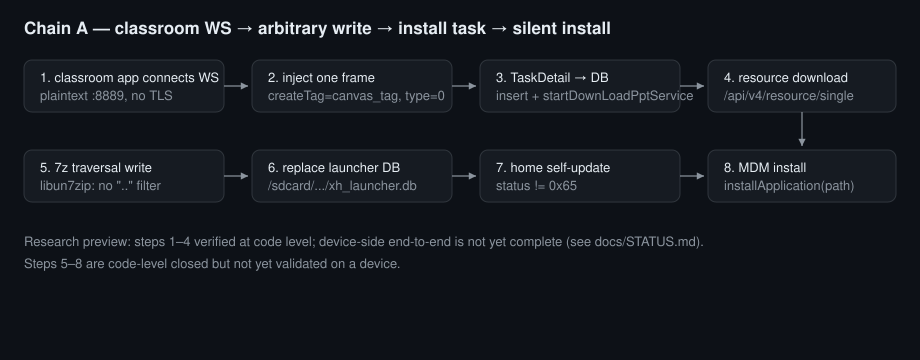

# O-XueHai-Unlocker

**Authorized security-research tooling for education-tablet kiosks: plaintext protocol responders, push-channel frame tooling, and hop-by-hop verification of a managed-device chain — all runnable locally.**

[](LICENSE)
[](requirements.txt)
[](#quick-start)
[](docs/STATUS.md)
[](SECURITY.md)

English · [中文](README.md)

---

## Table of contents

- [Overview](#overview)
- [Why this project](#why-this-project)
- [Features](#features)
- [Preview](#preview)
- [Quick start](#quick-start)
- [Minimal runnable example](#minimal-runnable-example)
- [Usage scenarios](#usage-scenarios)
- [Commands and configuration](#commands-and-configuration)
- [Architecture](#architecture)
- [Development and testing](#development-and-testing)
- [Roadmap and status](#roadmap-and-status)
- [Contributing](#contributing)
- [FAQ and troubleshooting](#faq-and-troubleshooting)
- [Security](#security)
- [License and credits](#license-and-credits)

---

## Overview

This is a **toolkit**, not a product: a set of independently runnable scripts plus reviewable analysis documents. Its purpose is to answer one question on a tablet **you own or are explicitly authorized to test**: *is the kiosk management chain actually closed?*

These devices usually expose no install channel, no listening ports, and keep their management logic inside closed-source apps. The only way to judge whether they can be taken over is to decompose the chain — plaintext protocols, push channel, download primitive, local database, install trigger — and obtain **code-level or byte-level evidence** for each hop.

**What this project does NOT do:**

- no one-click "bypass" button, and not a tool for end users;
- no attack code against third-party services, no denial-of-service code;
- no promise of end-to-end success — some hops are not yet device-verified (see [Roadmap and status](#roadmap-and-status));
- collects and uploads nothing; every script runs inside your local network only.

## Why this project

Four approaches are common for this problem. The comparison below weighs **research value**, not convenience:

| Approach | Physical access | Vendor signing | Account needed | What you get | Stance here |
|---|---|---|---|---|---|
| ADB / OTG sideload | Yes (cable, developer options) | No | No | One-off package install, fastest | Baseline only: device-side adb is often disabled by management |
| MDM re-enrollment | Yes (admin credentials) | No | **Yes** | Managed policy delivery | Rejected: requiring an account violates the "no account" constraint |
| Official firmware flash | Yes (download mode) | Yes (official image) | No | Wipes management | Recorded as an exit path, not the research main line |
| **Protocol-level takeover (this project)** | **No** (network position only) | No | No | Plaintext protocols, push channel, download and install triggers | Main line: make every step reviewable |

The difference: the first three assume you can touch the device or own an account; everything here happens on the **network side and code side**.

## Features

- **Protocol responders**: plaintext HTTP (DNS, service table, self-check file, file-box path), the 3200 push TCP channel, and the classroom plaintext WebSocket — all user-space, loggable implementations that can be diffed against packet captures.
- **Frame builder and reader**: verify frame structure (length encoding, msgId, CRC) without a device; get the payload right before touching the network.
- **Evidence grading**: `docs/METHODOLOGY.md` defines levels A–E; log files are explicitly **not accepted** — only code lines, byte streams, and reproducible command output.
- **Chain documentation**: `docs/CHAIN.md` lists a 21-hop table with the code location and gate for each hop, plus the attack surfaces already excluded, so others can refute it.
- **Test payloads**: sample APK, 7z traversal payload, HTML probes, self-signed certificates (local experiments only — see `payloads/lab-certs/README.md`).
- **No external assets**: all document images and badges are in-repo SVG; the only runtime dependency is `scapy`.

## Preview



Steps 1–4 are verified at code level; steps 5–8 are code-level closed but not yet validated end-to-end on a device. Hop-by-hop detail: [docs/CHAIN.md](docs/CHAIN.md).

## Quick start

> **Research Preview**: while the repository is in `1.x`, script names, environment variables, and `docs/` layout **may change in breaking ways**; pin a commit before reproducing.

### Prerequisites

| Item | Requirement |
|---|---|
| OS | Windows 10 / 11 (capture and injection rely on Npcap) |
| Python | 3.11+ (tested on 3.11.9) |
| Dependency | `scapy` (tested with 2.8.0) |
| Networking | Install **Npcap** with WinPcap-compatible mode |
| Privileges | Administrator rights for capture/injection |
| Environment | **Isolated lab network**: target device and lab machine form their own L2 segment; never run against production networks |

### Install

```bash
git clone https://github.com/OliverZhong20100/O-XueHai-Unlocker.git
cd O-XueHai-Unlocker
pip install -r requirements.txt
```

There is no packaged release and no `pip install o-xuehai-unlocker`; check out the repo and run the scripts.

### Verify

```bash
python tools/push_frame_tool.py
```

Expected output (observed):

```text
frame : 337 bytes, head=090103
length : content=332, encoded=2 bytes
msgId : 1750000000000  (roundtrip ok)
debug : mode=0 count=1
```

`roundtrip ok` means the frame encoder and decoder agree and the toolchain works.

## Minimal runnable example

No device, no administrator rights:

```bash
python tools/push_frame_tool.py
```

It builds one downlink message frame from the protocol specification, decodes it back with an independent decoder, and prints the field checks. Use it to confirm that your understanding of the protocol matches the tool's encoding before touching the network.

## Usage scenarios

### 1. Offline frame construction and readback

Debug protocol fields (length, msgId, nested JSON) without a device:

```bash
python tools/push_frame_tool.py
```

### 2. Observe real device traffic

Capture on the lab machine to see who the device talks to and whether traffic is plaintext or TLS:

```bash
python tools/wire_probe.py 60
```

Only new SYNs, segments carrying payload, and TLS ClientHello SNI are printed.

### 3. Run a plaintext responder and watch what the device requests

```bash
python tools/plaintext_http_responder.py
```

Impersonates a plaintext HTTP server at layer 2 and logs every path the device requests. **Use only on an isolated lab segment.**

### 4. Run an APK download canary

```bash
python tools/download_server.py
```

Listens on `DL_PORT` (default 8080) and appends every request (IP, method, path, UA, Range, bytes) to `dl_server.log` — useful to tell whether the download leg actually executed.

## Commands and configuration

None of the scripts expose `--help` / `--version` (no argparse); configuration is supplied through environment variables. Full list (keys, defaults, applicable script, known limits): **[docs/CONFIG.md](docs/CONFIG.md)**.

| Script | Purpose | Admin required |
|---|---|---|
| `tools/push_frame_tool.py` | Build and read back a push message frame offline | No |
| `tools/session_parser.py` | Parse the device push AUTH frame (accessKey / deviceId / uid / tags) | No |
| `tools/wire_probe.py` | Capture observation: new connections, payload segments, TLS SNI | Yes |
| `tools/plaintext_http_responder.py` | Layer-2 plaintext HTTP + DNS + service table + self-check file | Yes |
| `tools/push_channel_responder.py` | Impersonate the 3200 push TCP channel and inject downlink frames | Yes |
| `tools/download_server.py` | APK/payload download canary server | No |
| `tools/analysis/map_all_handlers.py` | Static mapping of handler type↔action | No |
| `tools/analysis/map_server_types.py` | Static mapping of service-table types | No |
| `tools/analysis/enum_js_bridges.py` | Enumerate WebView JS bridges and their methods | No |

**Precedence**: environment variables override built-in defaults. Every default is a lab placeholder (e.g. `CLASS_ID=CLASSROOM_ID`, `PUSH_USER_ID=1000001`) — **it does nothing until you replace it**.

## Architecture

Four layers, each independently verifiable:

1. **Network position (L2/L3)**: the lab machine must be the device's gateway or an on-path node in the same segment to observe or rewrite plaintext traffic. The docs record the negative result that ARP poisoning is not viable on the target network, so position must come from topology.
2. **Plaintext protocol surface**: the service address table, file-box self-check, release notes, push TCP channel, and classroom WebSocket are all plaintext. The responders cover those surfaces; `docs/CHAIN.md` records where each chain gets its base address and whether local input can rewrite it.
3. **Execution primitives**: download-to-path, 7z extraction (the native layer performs no `../` normalization), and a launcher database stored on shared storage — together these give "write arbitrary content to a deterministic path".
4. **Install trigger**: the install API exists (MDM silent install) but requires a task object; the last hop is making the launcher read that object by itself.

Evidence levels, excluded entry points, and failed attempts for each layer live in `docs/`, to avoid repeating dead ends.

## Development and testing

```bash
# Syntax check (no CI; run locally)
python -m py_compile tools/*.py tools/analysis/*.py
```

Conventions:

- new scripts must run **offline** and never call out to the internet; external addresses go through environment variables;
- before committing, remove `__pycache__/`, `*.log`, and raw captures;
- every command shown in docs must have been executed, with output pasted in the PR.

This repository **has no CI** (hence no CI badge): most scripts need Npcap and administrator rights, which hosted runners cannot provide.

## Roadmap and status

**Current status: Research Preview (v1.1.0)**

| Phase | Content | Status |
|---|---|---|
| 1 | Protocol reversal and documentation (push / classroom WS / plaintext service layer) | Done (code level) |
| 2 | Hop-by-hop review of the 21-hop main chain | Done (code level) |
| 3 | Single-point device validation: WS injection → download trigger | **Partial** (succeeded once; then blocked by an interception whitelist) |
| 4 | End to end: traversal extraction → database overwrite → automatic install | Not done (see the blocker table in `docs/STATUS.md`) |

> **Breaking-change risk**: during `1.x`, script names, environment variable names, and `docs/` layout may change; pin a commit to reproduce.

Planned direction (no timeline promised):

- complete validation of a bypass for the "message interception whitelist" blocking phase 3;
- turn the "inject → download → extract → database overwrite" observation points into a replayable script;
- add a sync check for the English documentation when needed.

## Contributing

See [CONTRIBUTING.md](CONTRIBUTING.md). Counter-evidence (proving a claim wrong), documentation fixes, and offline analysis scripts are welcome.

Not accepted: real-environment credentials or device identifiers, exploit code against third-party services, steps that require real student/teacher accounts.

## FAQ and troubleshooting

**`import scapy` fails / zero packets captured?**
Install Npcap (with WinPcap compatibility) and run from an administrator terminal. On some wireless adapters, BPF filters that include port conditions silently match nothing; the scripts use `filter="ip"` and filter by port in code.

**`bind(53)` fails with `WinError 10048`?**
Windows ICS owns UDP 53. The DNS logic here forges packets at the frame level and does not depend on the system port; the error can be ignored.

**Why is there no `--help`?**
This version deliberately stays "single file + environment variables" to minimize dependencies. See `docs/CONFIG.md` for the full table.

**Why are log files not accepted as evidence?**
Logs can be cached, truncated, or replayed, and they do not prove that bytes reached the peer. Only code lines, byte streams, and reproducible command output are accepted — see `docs/METHODOLOGY.md`.

**Can I use this to take over a school's tablet?**
No, and you should not. The tooling is only for devices you own or are explicitly authorized to test; unauthorized use may be illegal, and this project provides nothing that bypasses authorization.

## Security

See [SECURITY.md](SECURITY.md). Do not file vulnerabilities in third-party products through this repository's issues.

## License and credits

[MIT](LICENSE).

Credits: the Android/Linux open-source community, the scapy project, and every researcher who discusses kiosk management and mobile forensics in public.
