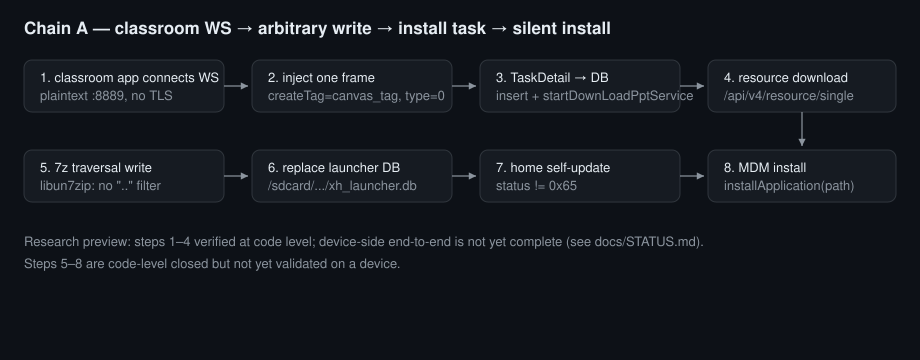

# O-XueHai-Unlocker
# Oliver
# Copyright © Oliver 版权所有
**学海教育平板三星SM-P200逆向破解项目**
**

[](LICENSE)
[](requirements.txt)
[](#快速开始)
[](docs/STATUS.md)
[](SECURITY.md)

[English](README.en.md) · 中文

---

## 目录

- [简介](#简介)
- [优势](#优势)
- [特性](#特性)
- [预览](#预览)
- [快速开始](#快速开始)
- [最小可运行示例](#最小可运行示例)
- [使用场景](#使用场景)
- [命令与配置参考](#命令与配置参考)
- [架构与工作原理](#架构与工作原理)
- [开发与测试](#开发与测试)
- [Roadmap 与状态](#roadmap-与状态)
- [贡献](#贡献)
- [FAQ 与故障排查](#faq-与故障排查)
- [安全披露](#安全披露)
- [许可证与致谢](#许可证与致谢)

---

## 简介

这是一个**工具集**，不是一个产品：仓库里是可独立运行的小脚本和可复核的分析文档，用来在一台**你拥有或已获书面授权**的教育平板上，验证"管控链路封闭性"。

它解决的问题很具体：这类平板通常没有可用的安装渠道、没有对外监听端口、管控逻辑藏在闭源 App 里。要判断"能不能被接管"，只能把每个环节拆开——明文协议、推送通道、下载原语、本地库、安装触发——逐环拿到**代码级或字节级**证据。

## 优势

同类需求通常有四条路，下面按**研究价值**而非"省事程度"对比：

| 方案 | 需要接触设备 | 需要厂商签名 | 需要账号 | 能拿到什么 | 本项目立场 |
|---|---|---|---|---|---|
| ADB / OTG 侧载 | 是（数据线、开发者选项） | 否 | 否 | 一次性装包，最快 | 已验证前提：设备侧 adb 常被管控关闭，仅作对照基线 |
| MDM 重新注册 | 是（需管理端凭据） | 否 | **是** | 受管设备策略下发 | 不做：需要账号即不满足"无账号"约束 |
| 刷官方固件 / 解锁 | 是（下载模式） | 是（官方包） | 否 | 清空管控 | 记录为退出方案，不作为研究主线 |
| **协议层接管（本项目）** | **否**（仅需网络位置） | 否 | 否 | 明文协议、推送通道、下载与安装触发链 | 主线：让每一步都可复核 |

差异点：前三者都假设"能碰设备"或"有账号"，本项目的全部工作都在**网络侧 + 代码侧**完成。

## 特性

- **协议栈应答器**：明文 HTTP（含 DNS、服务表、自检文件、文件盒子路径）、3200 推送 TCP 通道、课堂明文 WebSocket——均为用户态实现，日志可对照抓包。
- **帧构造与回读**：不接设备就能验证帧结构（长度编码、msgId、CRC），先把载荷做对再动网络。
- **证据分级方法**：`docs/METHODOLOGY.md` 把证据分为 A–E 五级，日志被明确列为**不采纳**，只接受代码行、字节流与可复现命令输出。
- **链路文档**：`docs/CHAIN.md` 用 21 跳表格给出主链每跳的"代码位置 + 门禁"，并列出已排除的攻击面，方便别人反驳。
- **测试载荷**：示例 APK、7z 越界载荷、HTML 探针、自签证书（仅本地实验，见 `payloads/lab-certs/README.md`）。
- **无外链依赖**：文档图片与徽章全部为仓库内 SVG；脚本仅依赖 `scapy`。

## 预览



图中 1–4 步为代码级已验证；5–8 步代码级闭合但尚未在真机上完成端到端验证。逐跳明细见 [docs/CHAIN.md](docs/CHAIN.md)。

## 快速开始

> **Research Preview 提示**：仓库处于 `1.x` 预览阶段，`tools/` 脚本与环境变量、`docs/` 结构**可能发生破坏性变更**；复现请先固定 commit。

### 前置条件

| 项 | 要求 |
|---|---|
| 操作系统 | Windows 10 / 11（抓包与包注入依赖 Npcap） |
| Python | 3.11+（实测 3.11.9） |
| 依赖 | `scapy`（实测 2.8.0） |
| 网络 | 安装 **Npcap**，勾选 WinPcap 兼容模式 |
| 权限 | 抓包/注入需要**管理员权限** |
| 环境 | **隔离实验网段**：目标设备与实验机自成二层网络，勿接生产网络 |

### 安装

```bash
git clone https://github.com/OliverZhong20100/O-XueHai-Unlocker.git
cd O-XueHai-Unlocker
pip install -r requirements.txt
```

仓库不分发包、不提供 `pip install o-xuehai-unlocker`；用法就是检出后直接跑脚本。

### 验证

```bash
python tools/push_frame_tool.py
```

预期输出（实测）：

```text
frame  : 337 bytes, head=090103
length : content=332, encoded=2 bytes
msgId  : 1750000000000  (roundtrip ok)
debug  : mode=0 count=1
```

看到 `roundtrip ok` 说明帧编解码自洽，工具链可用。

## 最小可运行示例

不需要设备、不需要管理员权限：

```bash
python tools/push_frame_tool.py
```

它做三件事：按协议规范构造一帧下行业务消息、用独立解码器回读、打印字段校验结果。适合先确认"你的协议理解"与"工具的编码"一致，再动网络。

## 使用场景

### 1. 离线帧构造与回读

调试协议字段（长度、msgId、嵌套 JSON）时不必连设备：

```bash
python tools/push_frame_tool.py
```

### 2. 观察设备真实流量

在实验机抓包，判断设备在连谁、走明文还是 TLS：

```bash
python tools/wire_probe.py 60
```

只输出"新 SYN / 带载荷的段 / TLS ClientHello 的 SNI"，避免刷屏。

### 3. 起一个明文应答器，看设备会请求什么

```bash
python tools/plaintext_http_responder.py
```

在二层冒充明文 HTTP 服务端，记录设备发起的每个路径。**只在隔离网段使用**。

### 4. 跑 APK 下载 canary

```bash
python tools/download_server.py
```

监听 `DL_PORT`（默认 8080），把每个请求（IP、方法、路径、UA、Range、字节数）写入 `dl_server.log`，用于判断"下载腿是否真的被执行"。

## 命令与配置参考

所有脚本**都没有 `--help` / `--version`**（未使用 argparse），配置一律走环境变量。完整列表（键、默认值、适用脚本、已知限制）见 **[docs/CONFIG.md](docs/CONFIG.md)**。

| 脚本 | 作用 | 需要管理员 |
|---|---|---|
| `tools/push_frame_tool.py` | 离线构造并回读推送消息帧 | 否 |
| `tools/session_parser.py` | 解析设备推送 AUTH 帧（accessKey / deviceId / uid / tags） | 否 |
| `tools/wire_probe.py` | 抓包观测：新连接、载荷段、TLS SNI | 是 |
| `tools/plaintext_http_responder.py` | 二层冒充明文 HTTP + DNS + 服务表 + 自检文件 | 是 |
| `tools/push_channel_responder.py` | 冒充 3200 推送 TCP 通道并注入下行帧 | 是 |
| `tools/download_server.py` | APK/载荷下载 canary 服务器 | 否 |
| `tools/analysis/map_all_handlers.py` | 静态解析消息处理器的 type↔action 映射 | 否 |
| `tools/analysis/map_server_types.py` | 解析服务表类型映射 | 否 |
| `tools/analysis/enum_js_bridges.py` | 枚举 WebView JS 桥及其方法 | 否 |

**配置优先级**：环境变量 > 脚本内置默认。所有默认值都是实验室占位（如 `CLASS_ID=CLASSROOM_ID`、`PUSH_USER_ID=1000001`），**不替换就没有效果**。

## 架构与工作原理

按"从网络到安装"分四层，每层可独立验证：

1. **二层/三层位置**：实验机需作为目标设备的网关或同名网段节点，才能看到/改写明文流量。文档记录了"ARP 毒化在目标网络上不可行"的反证，因此位置必须由网络拓扑保证。
2. **明文协议面**：目标 App 的服务地址表、文件盒子自检、版本说明、推送 TCP 通道、课堂 WebSocket 都是**明文**。仓库的应答器分别覆盖这些面；`docs/CHAIN.md` 记录每条链的基址来源与是否可被本地输入改写。
3. **执行原语**：下载→落盘、7z 解压（native 层无 `../` 规范化）、共享存储中的 launcher 数据库——三者构成"任意内容写入确定性路径"的原语。
4. **安装触发**：安装 API 本身存在（MDM 静默安装），但要求一个"任务对象"；最后一跳就是让 launcher 自己去读那个任务对象。

每层的证据级别、已排除入口与失败尝试都写在 `docs/` 中，避免重复踩坑。

## 开发与测试

```bash
# 语法检查（无 CI，本地执行）
python -m py_compile tools/*.py tools/analysis/*.py
```

约定：

- 新增脚本必须**离线可跑**、不主动连外网；外部地址一律走环境变量；
- 提交前清理 `__pycache__/`、`*.log`、抓包原文；
- 文档里出现的命令必须实际执行过，并在 PR 里贴输出。

本仓库**没有配置 CI**（因此也没有 CI 徽章）：多数脚本需要 Npcap 与管理员权限，托管 runner 上无法真实运行。

## Roadmap 与状态

**当前状态：Research Preview（v1.1.0）**

| 阶段 | 内容 | 状态 |
|---|---|---|
| 1 | 协议面逆向与文档化（推送 / 课堂 WS / 明文服务层） | 已完成（代码级） |
| 2 | 主链 21 跳逐跳核对 | 已完成（代码级） |
| 3 | 单点真机验证：WS 注入 → 触发下载 | **部分完成**（成功一次，随后被拦截白名单挡住） |
| 4 | 端到端：解压越界 → 库覆盖 → 自动安装 | 未完成（见 `docs/STATUS.md` 卡点表） |

> **破坏性变更风险**：`1.x` 期间 `tools/` 脚本名、环境变量名、`docs/` 结构都可能调整；复现请固定 commit。

后续方向（不承诺时间）：

- 补齐阶段 3 中"消息拦截白名单"绕过路径的验证；
- 把"注入帧 → 下载 → 解压 → 库替换"的观测点做成可重放脚本；
- 视需要增加英文文档同步检查脚本。

## 贡献

见 [CONTRIBUTING.md](CONTRIBUTING.md)。欢迎**反证**（证明某条结论不成立）、文档纠错、离线分析脚本。

不接受：真实环境凭据/设备标识、针对第三方服务的利用代码、需要真实师生账号的步骤。

## FAQ 与故障排查

**Q：`import scapy` 失败 / 抓到 0 个包？**
A：先装 Npcap（勾 WinPcap 兼容模式），再用管理员终端运行；部分无线网卡上带端口条件的 BPF 过滤器会静默失效，仓库脚本已改为 `filter="ip"` 后自行过滤。

**Q：`bind(53)` 报 `WinError 10048`？**
A：Windows ICS 自带 DNS 代理占用 UDP 53。仓库的 DNS 逻辑走包级伪造，不依赖系统端口，可忽略该报错。

**Q：为什么脚本没有 `--help`？**
A：这一版刻意保持"单文件 + 环境变量"的最小形态以减少依赖；配置全表见 `docs/CONFIG.md`。

**Q：为什么文档说"日志不算证据"？**
A：日志会被缓存、截断、重放，也无法证明"字节真的到达对方"。本项目只采纳代码行、字节流与可复现命令输出，详见 `docs/METHODOLOGY.md`。

**Q：能直接拿去接管一台学校的平板吗？**
A：不能，也不应该。工具仅用于你拥有或已获书面授权的设备；未授权使用可能违法，本项目不提供任何绕过授权的手段。

## 安全披露

见 [SECURITY.md](SECURITY.md)。

## 许可证与致谢

[MIT](LICENSE)。

致谢：Android/Linux 开源社区、scapy 项目，以及所有公开讨论 kiosk 管控与移动设备取证的研究者。
